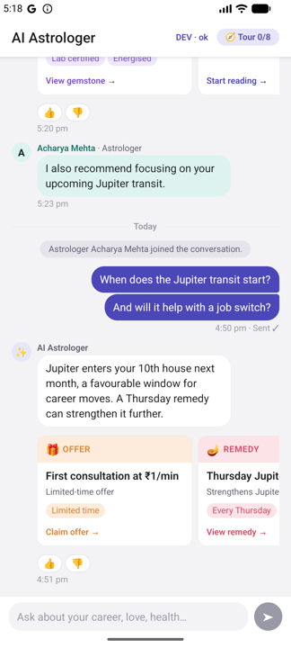
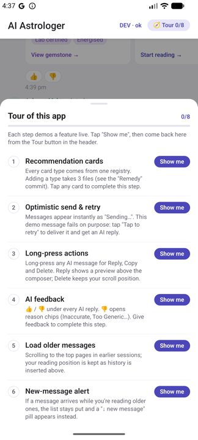
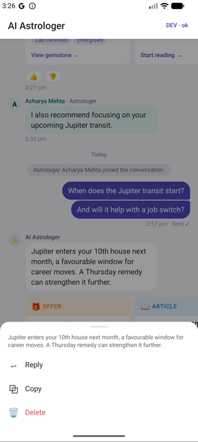
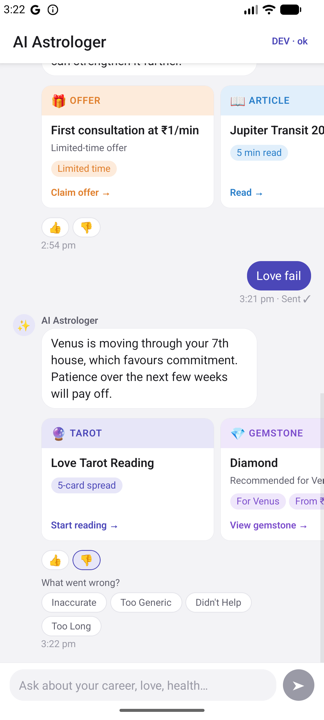
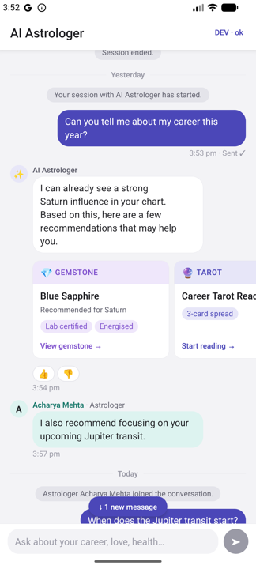
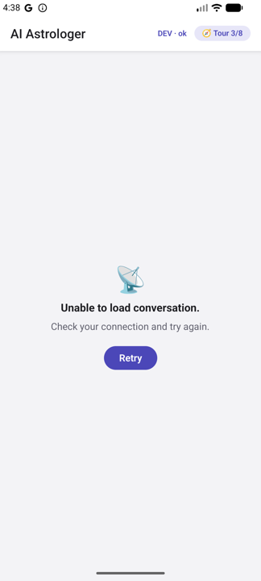
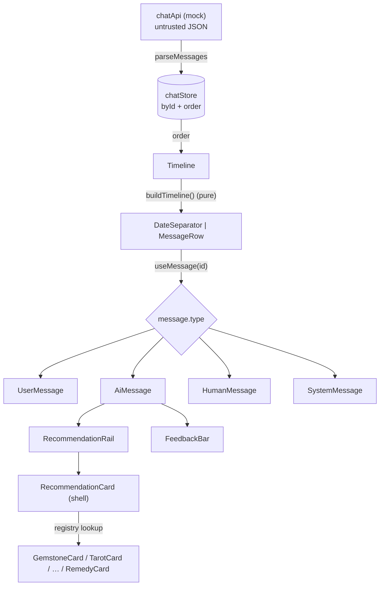

# MyNaksh: AI Conversation Experience

An AI astrology chat screen in React Native + TypeScript. AI replies can carry **recommendation cards** (gemstone, tarot, consultation, article, promotion, remedy), rendered by a **type registry**, so a new experience is added without touching the chat itself.

> 📹 **Demo video:** [Google Drive](https://drive.google.com/drive/folders/1vZWBFwRwimtdevzDZIqtltchSb9QdU-h?usp=drive_link)
>
> 🧭 **New here?** The app opens a **guided tour** after the conversation loads. Each step demos one feature live, so you don't need to hunt for anything. Reopen it from the **Tour** button in the header.

| Conversation | Guided tour | Long-press actions |
|---|---|---|
|  |  |  |

| AI feedback | New-message alert | Error state |
|---|---|---|
|  |  |  |

---

## Contents

- [Running it](#running-it)
- [Features](#features)
- [Project structure](#project-structure)
- [Component architecture](#component-architecture)
- [State management](#state-management)
- [Recommendation rendering strategy](#recommendation-rendering-strategy)
- [Performance considerations](#performance-considerations)
- [Testing & CI](#testing--ci)
- [Trade-offs](#trade-offs)
- [What I'd do next](#what-id-do-next)

---

## Running it

**Requirements:** Node ≥ 22.11, JDK 17 and Android SDK (Android); Xcode + CocoaPods (iOS).

```bash
npm install

# Android
npm run android

# iOS
cd ios && bundle install && bundle exec pod install && cd ..
npm run ios

# Checks (the same ones CI runs)
npm run typecheck && npm run lint && npm test
```

> Built and tested on the **Android emulator** (API 36). Pods are installed and the iOS project is the standard RN 0.87 template, but I didn't have full Xcode on my machine, so **iOS hasn't been run**.

### Build a shareable APK

```bash
npm run build:apk
# → dist/MyNaksh-<version>-<commit>.apk
```

This builds a release APK (JS bundled, no Metro needed) for phones (`arm64-v8a`, `armeabi-v7a`) and x86_64 emulators, and copies it to `dist/` with a versioned name. Share that file directly, or install it on a connected device:

```bash
adb install -r dist/MyNaksh-*.apk
```

`npm run build:android` runs the plain Gradle release build instead (output: `android/app/build/outputs/apk/release/app-release.apk`).

> The APK is signed with the template's debug keystore, so it installs by sideloading (allow "Install unknown apps") but isn't meant for the Play Store. In a release build the **DEV** toggle is hidden; the **Tour** button stays.

### Demo controls

| Control | What it does |
|---|---|
| **🧭 Tour** (header) | Guided checklist; every step has a live **Show me** |
| Message containing **"fail"** | First send attempt fails, so you can see **Retry** |
| **DEV · ok** (header, dev builds only) | Tap: cycle load scenario **ok → empty → error** |
| Long-press **DEV** | An astrologer message arrives in 3s (scroll up first to see the new-message pill) |

Mock behaviour (latency, 20% random send failure) is configured in `src/features/chat/api/chatApi.ts` → `mockConfig`.

---

## Features

**Part A: composable conversation**
- Timeline with **4 message types**: user, AI, human astrologer, system
- Virtualized list (FlashList v2), opens at the latest message, **auto-scroll only when you're near the bottom**
- **Date separators** ("Today", "Yesterday", dates) and **message grouping** (same sender, within 5 min, same day)
- **Recommendation framework:** multiple cards per AI message in a horizontal snapping rail; **6 types** from one registry; tap → single press handler (Alert)

**Part B: production interactions**
- **Long-press an AI message:** Reply (preview above composer, quoted in the sent message), Copy, Delete (position preserved)
- **AI feedback:** 👍 / 👎, with reason chips on 👎 (multi-select, stored in state)
- **Optimistic sending:** Sending… → Sent ✓ / Failed · Tap to retry; idempotent retries; simulated AI reply with typing indicator
- **States:** skeleton loading, empty state with suggested prompts, network error with Retry

**Extras**
- **Load older messages** (cursor pagination, position kept as history is inserted above)
- **"↓ N new messages" pill** when messages arrive while you're reading history
- **Analytics hook:** card impressions (counted only when actually on screen), taps, feedback
- **Guided tour** for reviewers
- **CI:** GitHub Actions runs typecheck, lint and tests on every push

---

## Project structure

Feature-first. `shared/` knows nothing about chat; `tour/` is a demo layer *on top of* chat, and chat doesn't import it.

```
src/
├── app/                      App root, providers, navigation
├── shared/
│   ├── analytics/            track() + pluggable sinks
│   ├── components/           BottomSheet, Chip, ErrorBoundary, Toast
│   ├── theme/                Design tokens (colors, accents, spacing, type)
│   └── utils/                Dates, ids, assertNever
└── features/
    ├── chat/
    │   ├── api/              Mock API (load, paginate, send, AI reply) + seed data
    │   ├── model/            Domain types, payload parsing, buildTimeline()
    │   ├── store/            Zustand chat store, per-row selectors, visibility store
    │   ├── recommendations/  ★ types, registry, card shell, rail, cards/
    │   ├── components/       timeline/, messages/, composer/, actions/, feedback/, states/
    │   ├── screens/          ChatScreen (composition only)
    │   ├── analytics.ts      Typed chat events
    │   └── demo.ts           Demo helpers shared by the dev toggle and the tour
    └── tour/                 Guided checklist (steps, store, sheet, header button)
__tests__/                    Jest + React Native Testing Library
```

---

## Component architecture



- **Shells own behaviour, leaves own content.** `MessageBubble` handles grouping corners and long-press; `RecommendationCard` handles press feedback, accessibility, title, CTA and error isolation. Variant components only render their specific body.
- **`MessageRow` subscribes to one message by id** and picks its component with an exhaustive `switch`. A new message type without a renderer is a compile error (`assertNever`).
- **`ChatScreen` only composes.** It holds no business logic: loading, sending, retry, feedback and paging are store actions.
- **Overlays** (action sheet, tour) share one `BottomSheet`, rendered in-screen rather than as a `Modal`. Android Modal windows stop short of the bottom edge in edge-to-edge mode.

---

## State management

**Zustand.** Little boilerplate, no provider re-render cascade, and selector-level subscriptions are exactly what a chat list needs.

- **Normalized:** `byId: Record<id, Message>` + `order: id[]`. Changing one message's feedback or status replaces only that entry, so **only that row re-renders**.
- **Pure core:** `upsertMessages()` (idempotent; re-sorts only when something arrives out of order) and `nextFeedback()` are plain functions with unit tests.
- **Side effects live in store actions** (`load`, `loadOlder`, `send`, `retry`). Components never call the API.
- **Optimistic send:** the client id *is* the local message id, so the row key stays stable from insert → sent → retry. The mock server is **idempotent on `clientId`**: retrying a message it already accepted returns the original result, so retries never create duplicates.
- **Lifecycle fencing:** every (re)load bumps a generation counter. A send result, AI reply or history page that resolves after a reload is dropped, so it can't leak into the new conversation.
- **Visibility** (which rows are on screen) lives in a separate tiny store, so scroll-driven updates never touch message state.

---

## Recommendation rendering strategy

The core of the assignment. A recommendation is a **discriminated union** on `type`, and **one registry** maps each type to its UI:

```ts
export const recommendationRegistry: RecommendationRegistry = {
  gemstone: { Content: GemstoneCard, label: 'Gemstone', icon: '💎', accent: accents.violet, defaultCtaLabel: 'View gemstone' },
  tarot:    { Content: TarotCard,    label: 'Tarot',    icon: '🔮', accent: accents.indigo, defaultCtaLabel: 'Start reading' },
  // … consultation, article, promotion, remedy
};
```

`RecommendationRegistry` is a mapped type over the union, so **forgetting to register a type is a compile error**, and each `Content` component is typed to receive exactly its own variant.

### Adding a new experience takes 3 steps

1. Add a variant to the `Recommendation` union (`recommendations/types.ts`)
2. Create its card body in `recommendations/cards/`
3. Add one entry to the registry

That's it: no changes to parsing, the card shell, the rail or the message components. **The `Remedy` type was added this way in its own commit** (`feat: add Remedy recommendation type`), so the git history shows the exact footprint.

### Safety for a server-driven UI

- **Untrusted payloads are validated** (`parseRecommendations`). Malformed entries and **unknown types are dropped**, not rendered, so a newer backend can ship a new experience without crashing older app builds. (I chose "skip" over a generic fallback card so users never see a half-supported experience.)
- **Each card body sits in its own `ErrorBoundary`.** One bad payload can't take down the message or its sibling cards. There's a test for this.
- **One press handler** (`handleRecommendationPress`) records the tap and shows an Alert. Deep links via `cta.action`, navigation or A/B logic would plug in here.

### Rail

A horizontal `FlatList` per AI message, with keys scoped as `messageId:recommendationId` (ids are only unique within a message). It is clipped to the screen gutter; the first card aligns under the bubble, and every later stop snaps a card flush to the gutter.

---

## Performance considerations

- **FlashList v2** with `getItemType` (`date` / `user` / `ai` / `human` / `system`), so AI rows with rails only recycle into AI rows.
- **Timeline rebuilds only when `order` changes.** Grouping depends on fields that never change after insert, so status and feedback edits skip `buildTimeline()` entirely. Rows are `memo`'d and subscribe to their own message by id.
- **Scroll anchoring is native** (`maintainVisibleContentPosition`): no manual `scrollTo` after deletes or when history is prepended, so there's no jump.
- **Pagination** starts half a screen before the top, guarded against concurrent and exhausted requests.
- **Animations run on the UI thread** (Reanimated): press feedback, sheet slide, chip fade, typing dots. They're kept short and simple on purpose.
- **Analytics impressions** are computed from viewability callbacks (no per-frame work) and deduplicated per session.
- **Stable callbacks and style objects** (`StyleSheet.create`, `useCallback`), so memoized rows actually stay memoized.

---

## Testing & CI

**71 tests** (Jest + React Native Testing Library) covering:

| Area | Covered |
|---|---|
| Timeline | date separators, grouping rules (sender, 5-min window, midnight, system, different astrologers) |
| Parsing | spec payload, unknown/malformed messages and recommendations dropped |
| Store | optimistic send, failure, idempotent retry, delete, feedback rules, reload fencing, overlapping replies |
| Pagination | ordering, exhaustion, concurrent calls, error + retry, reload fencing |
| Components | rail renders type-specific bodies, tap → handler, **crashing card isolated**, 👎 → chips, long-press |
| Analytics & tour | tap context, impression dedupe, failing sink isolated, event-driven tour steps |

CI (`.github/workflows/ci.yml`) runs `typecheck`, `lint` and `test` on every push and PR.

---

## Trade-offs

Made deliberately, mostly for time:

- **Mock backend only:** no WebSocket/real-time transport. The API module is shaped like REST (cursor pagination, idempotent POST), so swapping in a real client is a contained change.
- **No persistence.** The conversation and tour progress reset on relaunch, because I didn't want to add a native storage dependency for this scope.
- **iOS not run** (no full Xcode available). Keyboard avoidance uses `react-native-keyboard-controller` but was only partly checked: the Android emulator showed a floating keyboard, not a docked one.
- **Long-press actions on AI messages only**, as specified. The bubble component supports it for every type.
- **Unknown recommendation types are skipped** rather than shown as a generic card (see above).
- **No entering animations for new rows:** layout animations inside a recycling list risk visual glitches; I kept motion to UI that isn't recycled.
- **Light theme only**, though all colors already go through tokens.
- **Guided tour instead of a spotlight overlay:** measuring element positions inside a recycled, paginating list is fragile; a checklist with live demos is robust.

---

## What I'd do next

- WebSocket transport with reconnection, session recovery and server-side dedup by `clientId`
- Persist conversation + outbox (MMKV) so failed messages survive restarts and auto-retry when back online
- Deep links via `cta.action`, and a real analytics sink (CleverTap / Firebase) behind `setAnalyticsSink`
- Server-driven card layouts (per-type schema versioning)
- Swipe-to-reply, dark mode, and e2e tests (Maestro/Detox)
